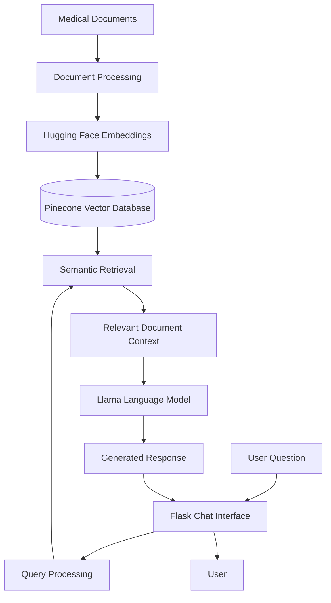

# 🏥 Medical Assistant — AI-Powered Healthcare Information Retrieval

<p align="center">
  An intelligent medical chatbot powered by Generative AI and Retrieval-Augmented Generation (RAG).
</p>

<p align="center">
  <b>Python · Flask · LangChain · Llama · Pinecone · Hugging Face</b>
</p>

---

## Overview

**Medical Assistant** is an AI-powered conversational application designed to make healthcare-related information easier to access through natural language interactions.

The project implements a Retrieval-Augmented Generation (RAG) pipeline that combines semantic search, vector embeddings, document retrieval, and Large Language Models (LLMs) to generate context-aware responses based on indexed medical documents.

Instead of relying exclusively on the language model's pretrained knowledge, the application retrieves relevant information from a medical document collection and uses that context to generate responses.

The application provides a web-based chatbot interface built with Flask, allowing users to interact with the system through conversational queries.

## Key Features

- **Retrieval-Augmented Generation (RAG):** Combines document retrieval with LLM-based response generation.
- **Semantic Document Search:** Retrieves relevant medical information using vector similarity.
- **LLM-Powered Conversations:** Uses a Llama-based language model for natural language question answering.
- **Vector Database Integration:** Uses Pinecone for storing and retrieving document embeddings.
- **Hugging Face Embeddings:** Converts document content into vector representations.
- **Interactive Web Interface:** Provides a conversational interface using Flask.
- **Context-Aware Responses:** Generates answers using relevant retrieved document content.
- **Environment Configuration:** Supports environment variables for sensitive configuration values.

## System Architecture

The application follows a Retrieval-Augmented Generation architecture.



## How It Works

1. **Document Processing:** Medical documents are prepared for indexing.
2. **Embedding Generation:** Hugging Face embedding models convert document content into numerical vectors.
3. **Vector Storage:** Generated embeddings are stored in Pinecone.
4. **User Query:** A user submits a healthcare-related question through the chatbot.
5. **Semantic Retrieval:** The application searches Pinecone for relevant document segments.
6. **Context Preparation:** Retrieved information is supplied as context to the language model.
7. **Response Generation:** The Llama-based model generates a response using the retrieved context.
8. **Response Delivery:** Flask delivers the generated response through the chatbot interface.

## Technology Stack

| Technology | Purpose |
|---|---|
| Python | Core application development |
| Flask | Web application and backend |
| LangChain | LLM and RAG orchestration |
| Llama | Language model |
| Pinecone | Vector database |
| Hugging Face | Embedding generation |
| CTransformers | Local language model integration |
| NLP | Natural language processing |
| dotenv | Environment configuration |

## Project Structure

```text
Medical_Assistants/
│
├── data/                 # Medical document data
├── model/                # Model-related resources
├── src/                  # Application helper modules
│
├── static/               # Static frontend assets
├── templates/            # HTML templates
│
├── app.py                # Main Flask application
├── store_index.py        # Vector index management
├── templates.py          # Prompt templates
├── setup.py              # Project setup configuration
├── requirements.txt      # Python dependencies
├── trail.ipynb           # Development notebook
│
├── .gitignore
├── LICENSE
└── README.md
```

## Installation and Setup

### 1. Clone the Repository

```bash
git clone https://github.com/MuhammadAnasAkhtar/Medical_Assistants.git

cd Medical_Assistants
```

### 2. Create a Virtual Environment

```bash
python -m venv venv
```

Activate the environment:

**Windows:**

```bash
venv\Scripts\activate
```

**Linux / macOS:**

```bash
source venv/bin/activate
```

### 3. Install Dependencies

```bash
pip install -r requirements.txt
```

### 4. Configure Environment Variables

Create a `.env` file in the project root directory.

```env
PINECONE_API_KEY=your_pinecone_api_key
```

Replace the placeholder with your actual Pinecone API key.

Never upload API keys or other sensitive credentials to GitHub.

### 5. Configure Pinecone

Create a Pinecone index named:

```text
medical
```

Ensure that the index configuration is compatible with the embedding model used by the application.

### 6. Run the Application

Start the Flask application:

```bash
python app.py
```

### 7. Access the Application

Open your browser and navigate to:

```text
http://localhost:8080
```

You can now interact with the medical chatbot.

## Configuration Requirements

Before running the application, ensure that:

- Python and the required dependencies are installed.
- Pinecone credentials are correctly configured.
- The required Pinecone index exists.
- Medical documents have been indexed.
- The configured language model is available.
- All environment variables are properly set.

## Potential Applications

- Medical document information retrieval.
- Healthcare knowledge exploration.
- Conversational access to medical documentation.
- Educational healthcare information systems.
- AI-powered document question-answering applications.

## Future Improvements

Potential improvements include:

- Support for uploading and indexing new medical documents.
- Improved conversational memory and chat history.
- Source citations for retrieved medical information.
- Better retrieval accuracy through hybrid search.
- Document metadata filtering.
- Evaluation of RAG response quality.
- Improved user interface and accessibility.
- Enhanced security and deployment capabilities.

## Limitations and Medical Disclaimer

This project is intended for educational purposes and healthcare information retrieval.

It is not a certified medical diagnostic system and should not be used as a substitute for professional medical advice, diagnosis, or treatment.

AI-generated responses may contain inaccurate or incomplete information. Always consult a qualified healthcare professional for medical decisions.

## License

This project is distributed under the MIT License. See the [LICENSE](LICENSE) file for details.

## Author

**Muhammad Anas Akhtar**

AI Engineer | Generative AI | RAG | Agentic AI | MLOps

- GitHub: [@MuhammadAnasAkhtar](https://github.com/MuhammadAnasAkhtar)
- Company: [TreliconAI](https://treliconai.com/)

---

<p align="center">
  <b>Built with Python and Generative AI.</b>
</p>
