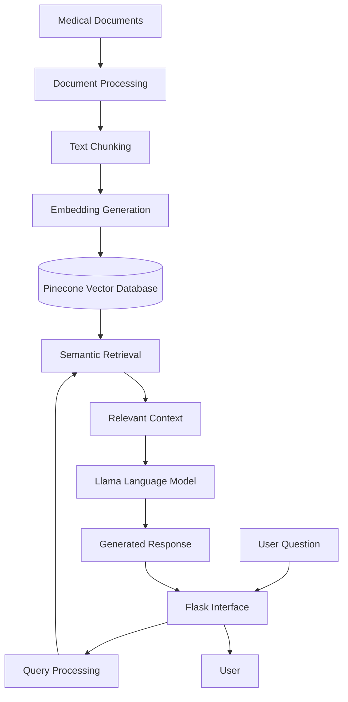

# 🏥 Medical Assistant — AI-Powered Healthcare Chatbot

<p align="center">
  An AI-powered healthcare information assistant built with Generative AI, Large Language Models (LLMs), and Retrieval-Augmented Generation (RAG).
</p>

<p align="center">
  Python • Flask • LangChain • Llama • Pinecone • Hugging Face
</p>

---

## 🚧 Project Status: Under Active Development

**Medical Assistant is currently under development and is NOT ready for production use or an official public launch.**

I am actively working on developing, configuring, testing, improving, and preparing this project for a professional release.

Currently, I have **no dedicated budget, external funding, or financial backing** for this project. Development is being carried out independently using available resources and tools.

My current priorities include:

- Improving application architecture and functionality.
- Optimizing RAG pipelines and retrieval accuracy.
- Testing LLM integrations and document processing.
- Improving security, reliability, and performance.
- Completing application configuration and deployment preparation.
- Improving documentation and user experience.
- Preparing for a professional public release.

**Public Release: Coming Soon**

Features, configurations, and installation instructions may change during development. Contributions, suggestions, and feedback are welcome.

---

## 📌 About the Project

Medical Assistant is an AI-powered conversational application designed to make healthcare-related information easier to access through natural language interactions.

The project uses Retrieval-Augmented Generation (RAG) to combine document retrieval, semantic search, vector embeddings, and Large Language Models.

Instead of relying entirely on pretrained model knowledge, the system retrieves relevant information from indexed medical documents and uses that context to generate responses.

The application is built around Python, Flask, LangChain, Llama, Pinecone, and Hugging Face embeddings.

The long-term objective is to develop a reliable and accessible healthcare information assistant using modern Generative AI technologies.

## ✨ Key Features

- **RAG Architecture:** Combines information retrieval with LLM-based response generation.
- **Semantic Search:** Retrieves relevant information using vector embeddings.
- **LLM Integration:** Uses Llama-based language models for conversational question answering.
- **Vector Database:** Integrates Pinecone for vector storage and retrieval.
- **Hugging Face Embeddings:** Supports semantic document representation.
- **Flask Backend:** Provides the web application infrastructure.
- **Context-Aware Responses:** Uses retrieved document context to support answer generation.
- **Expandable Architecture:** Provides a foundation for future healthcare AI improvements.

*Features and integrations are subject to ongoing development and testing.*

## 🧠 System Architecture

The intended RAG workflow:



## ⚙️ Technology Stack

| Technology | Purpose |
|---|---|
| Python | Core development |
| Flask | Web application backend |
| LangChain | RAG and LLM orchestration |
| Llama | Language model integration |
| Pinecone | Vector database |
| Hugging Face | Embedding models |
| CTransformers | Local model integration |
| NLP | Natural language processing |

## 📂 Repository

**GitHub Repository:**

https://github.com/MuhammadAnasAkhtar/Medical_Assistants

The repository contains the current development version of the project. Its structure and components may change as development progresses.

## 🚀 Installation and Setup

The following is the intended local setup workflow. Additional model and database configuration may be required depending on the current implementation.

### 1. Clone the Repository

```bash
git clone https://github.com/MuhammadAnasAkhtar/Medical_Assistants.git

cd Medical_Assistants
```

### 2. Create a Virtual Environment

```bash
python -m venv venv
```

Activate it on Windows:

```bash
venv\Scripts\activate
```

Linux/macOS:

```bash
source venv/bin/activate
```

### 3. Install Dependencies

```bash
pip install -r requirements.txt
```

### 4. Configure Environment Variables

Create a `.env` file in the project root.

```env
PINECONE_API_KEY=your_pinecone_api_key
```

Use the actual configuration required by the application. Never commit API keys or private credentials.

### 5. Configure the Vector Database

Configure your Pinecone account, index, embedding dimensions, and other settings according to the implementation.

### 6. Run the Application

If the current Flask entry point is `app.py`:

```bash
python app.py
```

If the application starts successfully, access its configured local address in your browser.

**Note:** Installation and execution instructions will be verified and finalized before the official release.

## 🛠️ Development Roadmap

- [x] Initial project development.
- [x] Initial RAG-based application implementation.
- [ ] Review and improve project architecture.
- [ ] Verify model and dependency compatibility.
- [ ] Improve document ingestion and processing.
- [ ] Optimize semantic retrieval.
- [ ] Improve response quality and reliability.
- [ ] Add source references for retrieved information.
- [ ] Improve interface and user experience.
- [ ] Complete security and configuration testing.
- [ ] Finalize installation and deployment documentation.
- [ ] Prepare the official public release.

## 💡 Future Vision

The long-term vision is to expand Medical Assistant into a more capable healthcare information platform.

Potential improvements include:

- Advanced RAG and hybrid retrieval.
- Conversational memory.
- Medical document uploads.
- Source-grounded responses.
- Better document management.
- RAG evaluation and performance monitoring.
- Improved user experience.
- Scalable deployment infrastructure.

These are development goals, not claims of currently implemented functionality.

## 🤝 Contributions and Feedback

Medical Assistant is an independently developed project.

Developers, AI engineers, researchers, and interested contributors are welcome to share:

- Technical suggestions.
- Bug reports.
- Feature requests.
- Architecture improvements.
- Development feedback.

Your feedback can help improve the project as it moves toward its first professional release.

## ⚠️ Medical Disclaimer

This project is an experimental AI-based healthcare information retrieval application.

It is not a certified medical device, diagnostic system, or substitute for professional medical advice, diagnosis, or treatment.

AI-generated information may be inaccurate, incomplete, or misleading. Always consult qualified healthcare professionals for medical decisions.

The application should not be used for emergency medical situations.

## 📄 License

See the [LICENSE](LICENSE) file for the project's licensing terms.

## 👨‍💻 Developer

**Muhammad Anas Akhtar**

AI Engineer | Generative AI | RAG | Agentic AI | MLOps

- GitHub: https://github.com/MuhammadAnasAkhtar
- Company: https://treliconai.com/

---

<p align="center">
  <b>Built with passion for Generative AI and practical innovation.</b>
</p>

<p align="center">
  Medical Assistant — Currently in Development.
</p>
